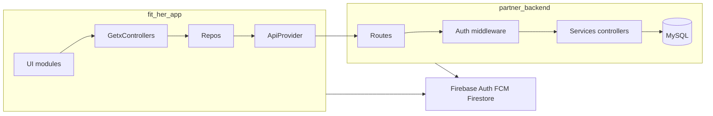
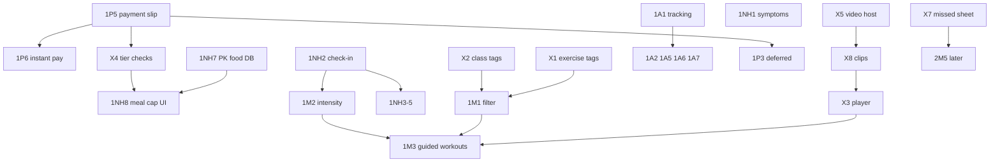

# FitHer — Architecture audit

**Date:** October 2026  
**Phase:** Audit only — no production data changes, dependency changes, or feature implementation  
**Requirements source:** `FitHer_Build_List_FINAL_full.pdf` (98 features + 7 foundations + 7 check/optimize items)  
**Codebases:** [`fit_her_app/`](../) (Flutter `fitness_zone_2` v13.0.0+22) · [`partner_backend/`](../../partner_backend/) (Express + Sequelize + MySQL)

**Related:** [implementation-plan.md](./implementation-plan.md)

---

## 1. Executive summary

FitHer is a **GetX-centric Flutter app** talking to a **monolithic Node/Express API**, with **Firebase** (Auth, FCM, Firestore chat), **in-app admin** (no separate web console), and **partial v2 UI** (paid home, progress hub, diet plan v2). The product matches much of the PDF’s “live” surface area, but **Delivery 1 revenue and safety paths are broken or incomplete**, **security holes remain on several API routes**, and **PDF Module 1 daily logging / guided workouts / video foundations are largely missing**.

**Approved scope boundaries (this audit):**

- **No new AI development** — classify AI-heavy PDF rows as **Deferred AI**; preserve existing Gemini (Luna, diet plan v2), Spoonacular/name-based meal flows.
- **Pipeline rows** → **Pending Client Approval** only.
- **1P8 trial** (approved product direction): plan-page **subscription** free trial — not the legacy 3-day `TrialJourney` class funnel alone.

---

## 2. Current architecture

### 2.1 Client (`fit_her_app`)

| Concern | Implementation | Risk / note |
|---------|----------------|-------------|
| Entry | `lib/main.dart` → Sentry, Firebase, `.env`, `get_di.init()` → `GetMaterialApp` | Single named route `/` (splash); all else `Get.to` |
| State | GetX controllers + `fenix: true` DI | Large controllers (`HomeController`, `HomeRepo` ~95 methods) |
| Network | `ApiProvider` (`http`), header `accessToken` | No refresh interceptor layer; 30s timeouts |
| Realtime | `SocketController` → same host as REST | CORS `*` on server affects web less; mobile OK |
| Theming | `lib/theme/AppTheme` + legacy `values/styles.dart` | Design system **not** app-wide |
| Config | `flutter_dotenv` — `BASE_URL`, keys in `.env` asset | No committed `.env.example` |
| Tests | ~18 test files — strong on pure services | Weak on screens, payment, auth E2E |

### 2.2 Server (`partner_backend`)

| Concern | Implementation | Risk / note |
|---------|----------------|-------------|
| Entry | `app.js` — HTTP + Socket.io, `sequelize.sync()` | GraphQL deps unused (dead code) |
| Auth | `validateToken` / `validateAdmin`; JWT in `accessToken` | Dual secrets (`JWT_ACCESS_SECRET` vs `JWT_SECRET`) |
| Data | ~70 Sequelize models, migrations folder | `config/config.json` has env DB passwords in repo |
| Jobs | cron + Bull notification worker | Trial/reminder logic split across systems |
| AI (existing) | Vertex/Gemini in `services/ai/` | Server-side only — **preserve**, do not extend scope |

### 2.3 Data flow (logical)

---

## 3. Classification legend

| Classification | Use when |
|----------------|----------|
| **Complete** | PDF “Done when” met on staging/test accounts |
| **Partially Complete** | Shipped but gaps vs PDF or audits |
| **Missing** | Not built |
| **Broken** | Built but known failing or unreachable in production paths |
| **Deferred AI** | New or extended AI — out of scope; keep existing AI only |
| **Pending Client Approval** | PDF Pipeline — do not build until written confirmation |
| **Blocked** | Needs client content, credentials, or third-party approval |

---

## 4. Master requirement map (every PDF ID)

### 4.1 Delivery 1 — Check & optimize (7)

| ID | Feature | Classification | Evidence / gap |
|----|---------|----------------|----------------|
| 1A1 | Dashboard & event tracking | Partially Complete | Mixpanel + `AnalyticsService`; admin metrics v2 partial; no unified founder dashboard or full event schema |
| 1A2 | Payment journey audit | Partially Complete | Stripe/DirectPay/slip paths exist; **1P5 broken**; funnel not instrumented end-to-end |
| 1A3 | User flow audit | Partially Complete | `lib/docs/*_audit.md`; no systematic funnel per screen |
| 1A4 | Performance & capacity | Partially Complete | Sentry; no published cold-start/API/load benchmarks |
| 1A5 | Upsell audit | Partially Complete | Scattered paywalls; incomplete feature flags (**2P5** missing) |
| 1A6 | Engagement audit | Partially Complete | `notification_scheduler`; quiet hours/caps/segments incomplete |
| 1A7 | Journey optimization | Missing | Depends on **1A1** metrics and fixes from 1A5/1A6 |

### 4.2 Delivery 1 — Foundations (7)

| ID | Feature | Classification | Evidence / gap |
|----|---------|----------------|----------------|
| X1 | Exercise list with tags | Missing | No vetted tagged exercise CMS |
| X2 | Live class tags | Partially Complete | Intensity tags exist; full body/impact/style set incomplete |
| X3 | Workout player + mark done | Missing | No step-by-step guided player |
| X4 | Tier counters & checks | Partially Complete | Plan status/freeze routes exist; monthly session counters & server gates incomplete |
| X5 | Video hosting & upload | Missing | Large bundled assets; no stream-first admin publish pipeline |
| X7 | Missed session sheet + actions | Missing | Reminder exists; **no Join next / Find similar**; F-02 session data |
| X8 | Animated exercise clips | Blocked | Requires trainer content + **X5** + per-move quote |

### 4.3 Delivery 1 — Nutrition & hormones (15)

| ID | Feature | Classification | Evidence / gap |
|----|---------|----------------|----------------|
| 1NH1 | Daily symptom logging | Partially Complete | Symptoms mainly Day 15/30 progress forms |
| 1NH2 | Quick daily check-in | Missing | `checkin_repository` without unified 4-field daily screen |
| 1NH3 | Energy logging | Partially Complete | Home widgets; not tied to single check-in record + phase |
| 1NH4 | Stress logging | Partially Complete | Same as 1NH3 |
| 1NH5 | Sleep logging | Partially Complete | Paid home sleep modals; PDF “one source of truth” not verified |
| 1NH6 | Water logging | Partially Complete | Backend `water.js` + home UI; confirm vs PDF |
| 1NH7 | Pakistani food database | Missing | Spoonacular/global only; dietitian content not in repo |
| 1NH8 | AI meal photo capped (Free) | Partially Complete + **Deferred AI** | Name/Spoonacular not true photo AI; daily not monthly cap |
| 1NH9 | Edit/correct logged meal | Partially Complete | `v2_edit_meal_sheet` |
| 1NH10 | Unlimited meal photo (Plus) | Partially Complete + **Deferred AI** | No plan-based photo cap enforcement |
| 1NH11 | Behavior signal capture | Partially Complete | Mixpanel; not wired to recommendations |
| 1NH12 | Luna daily advisor | Partially Complete + **Deferred AI** | Gemini batch exists — **preserve**; PDF 5-part card + rules not complete |
| 1NH13 | Phase nudge notifications | Partially Complete | Re-engagement pushes; rule table per phase incomplete |
| 1NH14 | Daily phase message (Free) | Partially Complete | Locked Luna on unpaid; generic phase variants incomplete |
| 1NH15 | Smart log reminders | Missing | No learned-time multi-type reminders |

### 4.4 Delivery 1 — Movement (6)

| ID | Feature | Classification | Evidence / gap |
|----|---------|----------------|----------------|
| 1M1 | Injury/limitation filter | Partially Complete | Onboarding collects; no filter on moves/classes |
| 1M2 | Phase adaptive intensity | Partially Complete | “Recommended” on classes; needs 1NH3–5 inputs |
| 1M3 | Animated guided workouts | Missing | Depends X1, X3, X5, X8 |
| 1M4 | Voice/written form cues | Missing | With 1M3 |
| 1M5 | Post-workout feedback | Missing | |
| 1M6 | Streaks + milestone badges | Partially Complete | Streak in `motivation_controller`; badges **Missing** |

### 4.5 Delivery 1 — Platform & growth (15)

| ID | Feature | Classification | Evidence / gap |
|----|---------|----------------|----------------|
| 1P1 | AI first-pass moderation | Partially Complete + **Deferred AI** | Human admin approval only; no AI scan |
| 1P2 | Approved content library | Missing | |
| 1P3 | AI sales/support assistant | Missing + **Deferred AI** | |
| 1P4 | Report, block, anonymous post | Partially Complete | Verify posts module completeness |
| 1P5 | Payment slip fix & states | **Broken** | PDF P-01: picker/camera error timing; blocks **X4**, upsells |
| 1P6 | Instant payment activation | Partially Complete + **Blocked** | DirectPay/Zindigi stubs; merchant credentials |
| 1P7 | Plan page & paywall | Partially Complete | Card differentiation/copy issues per PDF |
| 1P8 | Free trial & first week | **Broken** / Missing vs PDF | TrialJourney (3-day classes) ≠ plan-page subscription trial |
| 1P9 | Upgrade moments | Partially Complete | |
| 1P10 | Home one daily focus | Partially Complete | v2 home exists; single focus card incomplete |
| 1P11 | Fix broken screen details | Partially Complete | Ongoing UI audit items |
| 1P12 | Personal first week | Partially Complete | |
| 1P13 | Renewals, freeze, win-back | Partially Complete | `plan_freeze` API exists; UX/notifications gaps |
| 1P14 | Privacy notice, hidden admin login | Partially Complete | |
| 1P15 | Smaller, faster app | Partially Complete | Tied to **X5** and dependency/asset audit |

### 4.6 Delivery 2 — Nutrition (14)

| ID | Feature | Classification |
|----|---------|----------------|
| 2NH1 | Food preferences & allergies | Missing |
| 2NH2 | Phase-aware food scoring | Missing (rules; blocked on meal quality) |
| 2NH3 | Auto weekly diet adjustment | **Deferred AI** |
| 2NH4 | AI grocery list | **Deferred AI** |
| 2NH5 | Appetite & cravings logging | Missing |
| 2NH6 | Digestion logging | Missing |
| 2NH7 | Medications & supplements | Missing |
| 2NH8 | Period flow & spotting | Missing |
| 2NH9 | Skin & hair logging | Missing |
| 2NH10 | Weekly symptom pattern report | Partially Complete (progress v2; **beta gate**) |
| 2NH11 | Weekly progress summary | Partially Complete |
| 2NH12 | Doctor-ready PDF export | Partially Complete (PDF service; sections/gating) |
| 2NH13 | Monthly nutrition/body report | Missing (AI summary **Deferred AI**) |
| 2NH14 | Period predictor enrichment | Missing |

### 4.7 Delivery 2 — Movement (12)

| ID | Feature | Classification |
|----|---------|----------------|
| 2M1 | Time & energy picker | Missing |
| 2M2 | Swap exercise | Missing |
| 2M3 | Auto progression | Missing |
| 2M4 | Rest day suggestion | Missing |
| 2M5 | Missed session recovery workout | Missing (needs **X7**, **1M3**) |
| 2M6 | Today’s plan card | Missing |
| 2M7 | Enhanced streaks | Missing |
| 2M8 | Fuel tips around workouts | Missing |
| 2M9 | Women-specific basic sets | Missing (+ clinical content) |
| 2M10 | Progress photo timeline | Partially Complete (admin-only photos) |
| 2M11 | Milestone sharing | Partially Complete |
| 2M12 | Cast to TV | Missing + **Blocked** (live stack vendor) |

### 4.8 Delivery 2 — Platform (7)

| ID | Feature | Classification |
|----|---------|----------------|
| 2P1 | AI content poster | **Deferred AI** |
| 2P2 | AI community manager | **Deferred AI** |
| 2P4 | AI cost monitor | Partially Complete (needs **1A1** cost events) |
| 2P5 | Remote controls / feature flags | Missing |
| 2P6 | Referral program | Missing |
| 2P7 | Community streak visibility | Missing |

*(2P3 founder dashboard → merged into **1A1**.)*

### 4.9 Delivery 3 — Nutrition (7)

| ID | Feature | Classification |
|----|---------|----------------|
| 3NH1 | AI nutritionist | **Deferred AI** |
| 3NH2 | Ramadan mode | **Pending Client Approval** |
| 3NH3 | Daily note | Missing |
| 3NH4 | Tone/style personalization | Partially Complete + **Deferred AI** (variants) |
| 3NH5 | Cycle calendar plan ahead | **Pending Client Approval** |
| 3NH6 | Gentle red flag guidance | **Pending Client Approval** |
| 3NH7 | Lab report upload | **Pending Client Approval** |

### 4.10 Delivery 3 — Condition modules (8)

| ID | Feature | Classification |
|----|---------|----------------|
| 3H1 | Module engine (config-driven) | Partially Complete (text to AI diet only) |
| 3H2 | PCOS module | Partially Complete (screening + diet hint) |
| 3H3 | Postpartum module | Partially Complete (signup + class locks) |
| 3H4 | Thyroid module | Partially Complete (screening) |
| 3H5 | Endometriosis module | Partially Complete (screening only) |
| 3H8 | PMS/PMDD module | **Pending Client Approval** |
| 3H9 | Perimenopause module | **Pending Client Approval** |
| 3H11 | Trying to conceive module | **Pending Client Approval** |

### 4.11 Delivery 3 — Movement (8)

| ID | Feature | Classification |
|----|---------|----------------|
| 3M1 | Recorded class library | Missing |
| 3M2 | Trainer style filter | Missing |
| 3M3 | Full library (Unlimited) | Missing |
| 3M4 | Micro sessions | **Pending Client Approval** |
| 3M5 | Live class replays | **Pending Client Approval** |
| 3M6 | Four-week programs | **Pending Client Approval** |
| 3M7 | Low data / download mode | **Pending Client Approval** |
| 3M8 | Favourites & continue watching | **Pending Client Approval** |

### 4.12 Delivery 3 — Platform (7)

| ID | Feature | Classification |
|----|---------|----------------|
| 3P1 | Privacy lock & discreet mode | **Pending Client Approval** |
| 3P2 | Urdu & Roman Urdu | **Pending Client Approval** |
| 3P3 | Health Connect sync | **Pending Client Approval** |
| 3P4 | Gift / family plan | **Pending Client Approval** |
| 3P5 | Group plans (B2B) | **Pending Client Approval** |
| 3P6 | Points for streaks | **Pending Client Approval** |
| 3P7 | Free website tools | **Pending Client Approval** |

### 4.13 Summary counts (approximate)

| Classification | Count (IDs listed above) |
|----------------|--------------------------|
| Complete | ~6 (mostly “live” baseline + core live classes) |
| Partially Complete | ~45 |
| Missing | ~35 |
| Broken | 2–3 (**1P5**, **1P8** vs product, Day7 safety path) |
| Deferred AI | ~12 |
| Pending Client Approval | ~22 |
| Blocked | 2 (**X8**, **1P6** merchant, **2M12** vendor) |

---

## 5. Features that must be preserved (14 live)

Regression tests required before any release. Do **not** break:

1. Cycle/period date prediction (`cycle_repo`, cycle engine)  
2. Mood logging (until replaced by unified **1NH2**)  
3. Hormonal wellbeing / phase logic (`insight_service`)  
4. **AI diet plan on request** (Diet Plan v2 + backend Vertex — preserve behavior)  
5. Unlimited live sessions / 9 daily slots (workout bottom, Zoom)  
6. Missed session **notification** (upgrade with **X7**, don’t remove alert)  
7. Progress hub (v2; respect beta users during migration)  
8. Onboarding preference quiz  
9. Session thumbs feedback  
10. Community feed & posting  
11. Ad-free Plus experience (verify server-side **X4**)  
12. Multi-month savings & USD pricing on plans  
13. Social login (Google/Apple → `/admin/socialLogin`)  
14. Existing paid user plan activation paths once **1P5** fixed  

---

## 6. Bugs and broken product paths

| Severity | Area | Description | IDs |
|----------|------|-------------|-----|
| P0 | Payments | Slip upload camera/gallery race; premature “select image” error | **1P5**, **1A2** |
| P0 | Trial | Two backend trial systems; UI ≠ PDF **1P8** subscription trial | **1P8**, **1P12** |
| P0 | Diet safety | Day 7 review / flagged client screens **unreachable**; escalation doesn’t update plan status | **2NH10**, clinical |
| P0 | Backend | `POST /appointment/` create **without auth**; `DELETE /appointment/:id` **without auth**; `GET /dietAppointments/:id` exposes PII | **1A3** |
| P1 | Diet UI | `DietPlansOfUser` no loading/error; blocking dialog can stick (`addDaySlots`) | **1A3** |
| P1 | Appointments | Double-book race (no transaction on create) | **1A3** |
| P1 | Client parse | `Cliet.fromJson` fallback crash; fragile diet plan JSON parses → infinite spinners | **1A3** |
| P1 | Home | `showDotHome` cold-start logic inverted (`test_audit_report.md`) | **1A6** |
| P1 | Dietitian | `ClientDetailsScreen` hardcoded fake medical history (PCOS) | **1A3**, trust |
| P2 | Legacy dead code | `DietBottomBarScreen` orphaned; duplicate availability models | maintainability |
| P2 | Status update UI | Appointment status update success but list not refreshed | **1A3** |

---

## 7. Security vulnerabilities

| Issue | Location | Recommendation |
|-------|----------|------------------|
| DB passwords in git | `partner_backend/config/config.json` | Env-only config; rotate credentials |
| JWT logged at startup | `AdminController.js` | Remove log line |
| Open CORS / Socket `origin: *` | `app.js` | Restrict to app origins |
| Admin routes without `validateAdmin` | Various `/admin/*` | Auth matrix + fix |
| Unauthenticated appointment CRUD/read | `appointmentRoutes.js` | `validateToken` + ownership checks on all mutating/list routes |
| Passwords in SharedPreferences | `auth_controller` | Secure storage for secrets; never store plaintext password |
| API keys in client | Spoonacular in `.env`/code; Firebase keys in `firebase_options.dart` | Proxy nutrition via backend; restrict Firebase API keys |
| Client calls Spoonacular directly | `get_food_kcal_details.dart` | Backend quota + secret protection |
| Dual JWT secret env vars | `AuthorizationMW` vs `authMiddleware` | Single secret strategy |
| Consultation endpoints | Historical audit — verify each route after appointment pass | Pen test staging |
| No rate limiting / helmet | `forgot_password_security_audit.md` | Add on auth/OTP/payment |

---

## 8. UI/UX and responsiveness

| Issue | Detail | PDF touchpoints |
|-------|--------|-----------------|
| Dual design systems | `AppTheme` vs legacy styles | Premium redesign |
| Fixed design size | `ScreenUtilInit` 414×896 — overflow on small/large phones if not constrained | **1A3**, **1P11** |
| Form errors via Toast | Widespread `fluttertoast` / `CustomToast` for validation | Mandatory inline validation |
| No scroll-to-first-error | Forms don’t use shared pattern | All forms |
| Progress hub beta | Users may never see reports | **2NH10**, live “progress” |
| Plan cards | Same look, copy errors | **1P7** |
| Keyboard | Some screens use `adjustResize` (Android OK); verify iOS safe area + bottom CTAs | **1A3** |
| Empty/loading states | Diet tab, several v2 sections identical for load vs empty vs error | **1P11** |
| Accessibility | Text scaling / reduced motion not systematically handled | Cross-cutting |
| Tablet | No max-width column layout | Low priority |

---

## 9. Backend and database improvements

| Area | Current | Target |
|------|---------|--------|
| Auth consistency | Mixed middleware | Every route documented; default-deny |
| Transactions | Missing on appointment create | Row lock pattern (exists elsewhere in codebase) |
| Tier enforcement | Mostly client `status` | Server counters for sessions, photo caps, library (**X4**) |
| Trial model | `TrialJourney` + legacy `FreeTrailUsers` | Single **1P8** subscription trial entity |
| Diet escalation | Tickets without plan status | `DietPlan.status` escalated + user/dietitian notification |
| Feature flags | Hardcoded / absent | **2P5** remote config table |
| Migrations | Ad hoc sync | Versioned migrations with rollback |
| Idempotency | Payment webhooks | Duplicate payment prevention (**1A2**) |
| Indexes | Unknown | Audit slow paths: home, plans, posts, logs (**1A4**) |
| Audit log | Partial admin actions | Admin mutations logged (**1A1**) |
| GraphQL | Unused deps | Remove or implement (cleanup only, later) |
| Content CMS | — | **1P2**, **X1**, **1NH7** admin CRUD + versioning |

**APIs present but underused or missing (vs PDF):**

- Present: cycle, water, plan freeze, meal logs v2, trial, DirectPay, progress, posts, check-in fragments  
- Missing / incomplete: daily symptom/check-in aggregate API, Pakistani food search, exercise tag filter, recorded class stream URLs, behavior signals store, founder analytics aggregate, report batch jobs (weekly/monthly), anonymous post flag, moderation queue  

---

## 10. Performance bottlenecks

| Bottleneck | Evidence | Mitigation |
|------------|----------|------------|
| App size ~570MB (PDF) | Bundled video/assets | **X5** streaming; asset audit (**1P15**) |
| God objects | `HomeController`, `HomeRepo` | Split by feature repos; lazy fetch |
| Duplicate YouTube stacks | `youtube_player_flutter` + `iframe` + `inappwebview` | Consolidate after audit |
| N+1 home loads | Multiple parallel calls on home init | Batch endpoints / caching |
| Large Syncfusion suite | Multiple syncfusion packages | Use only required widgets |
| `sequelize.sync()` at boot | Schema drift risk | Migrations only in prod |
| No pagination on some lists | Admin user lists, posts | Cursor pagination |
| Image upload | Slip/meal photos | Compress (exists); CDN |
| Offline | Limited | Queue daily logs (**1NH1–6**) later |
| Cold start | Splash 3s + Firebase + DI | Measure (**1A4**), defer non-critical init |

---

## 11. Feature dependencies (PDF order)

### Delivery 1 critical path

**Parallel tracks:** Content (X1, X8, 1NH7) vs app engineering (1P5, 1NH2, security). **1A1** should start early to measure all audits.

### Delivery 2 dependency highlights

- **2NH1** before scoring/plan/grocery  
- **1NH1 + 1NH2–5** before **2NH10–14**  
- **2NH8** before **2NH14**  
- **1M3 + X7** before **2M5, 2M6**  
- **1M6** before **2M11**  
- **2P5** before remote caps (**1NH10**, **3M3**)

### Delivery 3 dependency highlights

- **3H1** engine before **3H2–5** completion  
- **2NH5/7/9** before PCOS module completion (**3H2**)  
- **X5 + 3M1** before library features  
- Pipeline **3M4–8, 3P\*, 3NH2,5–7, 3H8/9/11** — no engineering until approved  

---

## 12. Client-provided content and credentials

| Item | Required for IDs |
|------|------------------|
| Merchant account (JazzCash/Easypaisa/card) | **1P6** |
| Payment gateway test + live keys | **1P5**, **1P6**, **1A2** |
| Trainer vetted exercise list + animations quote | **X1**, **X8**, **1M3**, **2M9** |
| Video CDN/host + upload SOP | **X5**, **3M1**, **1P15** |
| Pakistani food data (dietitian sign-off) | **1NH7**, **3P7** |
| Approved FAQ/articles/myth-fact library | **1P2**, **1P3** (deferred) |
| Doctor/dietitian reviewed wording | **1NH12**, **2NH12**, **3H\***, **3NH6** |
| Real testimonials / credentials for paywall | **1P7** |
| Peak concurrent users for load test | **1A4** |
| Live class video vendor (Cast/TV) | **2M12** |
| Moderation policy (publish-first vs hold) | **1P1** |
| Active vs Unlimited library split rule | **3M3** |
| Foundation written confirmation (PDF Part 5) | **X1–X8** delivery commitment |

---

## 13. Android / iOS compatibility

| Topic | Android | iOS |
|-------|---------|-----|
| SDK | `compileSdk` / manifest permissions for camera, mic, Zoom | Info.plist usage strings present |
| Cleartext HTTP | `usesCleartextTraffic=true` | `NSAllowsArbitraryLoads=true` — needed for dev; **restrict in prod** |
| Storage permission | Legacy `STORAGE` — review scoped storage Android 13+ | Photo library strings OK |
| Deep links | App Links `backend.thefither.com` + ngrok dev filters | Verify associated domains / custom scheme `fither://payment` |
| Payment return | Intent filters for DirectPay | URL schemes in Xcode |
| Notch / safe area | `SafeArea` audit on v2 home | Dynamic Island — test top padding |
| Image picker | **1P5** broken path — test CameraX vs gallery | PHPicker permissions |
| Background | FCM + `remote-notification` | Push capability |
| WebView payments | `flutter_inappwebview` for Payin PWA | WKWebView cookie/session |
| Install referrer | `play_install_referrer` (Android trial attribution) | iOS equivalent via universal links only |
| Tablet | Not optimized | Same |

---

## 14. Prioritized implementation checklist

### Delivery 1 (ordered — excludes new AI & Pipeline)

**Wave 0 — Measure & money (weeks 1–2)**  
1. **1A1** — Event schema + founder dashboard MVP  
2. **1P5** — Fix broken slip upload (**Broken → Complete**)  
3. **1A2** — Payment journey map + webhook/idempotency review  
4. Security P0 — Appointment auth, admin RBAC, secrets (**no prod DB writes without approval**)  
5. **1P8** — Subscription trial (replace dual trial confusion)  
6. **1A3** — Severity 1–2 flow fixes (Day7 navigation, diet loading states)  
7. **X7** — Missed session sheet + session data F-02  

**Wave 1 — Daily value & gates (weeks 3–6)**  
8. **1NH2** → **1NH1** → confirm **1NH3–6** single store  
9. **X4** — Server tier counters + photo cap enforcement (non-AI)  
10. **1NH15** + **1A6** caps/quiet hours  
11. **1M1**, **1M2** (with check-in data)  
12. **1P7**, **1P9–1P13**, **1P10–1P12**, **1P14**  
13. **1P2** human content library (non-AI) + **1P4** safety  
14. **1P6** when credentials arrive  

**Wave 2 — Foundations & movement core (weeks 6–10, parallel content)**  
15. **X2** complete class tags  
16. **X1** + **X5** (content + backend)  
17. **X8** (blocked until quote) → **X3** → **1M3**, **1M4**, **1M5**, **1M6** badges  
18. **1NH7** first batch Pakistani foods  
19. **1NH9** + meal cap UI (**1NH8/10** tier/limit only — **Deferred AI** for vision)  
20. **1NH11–14** rules/templates (**Deferred AI** for Luna expansion)  
21. **1A4**, **1A5**, **1A7**, **1P15**  

**Deferred AI in D1 (interfaces only):** **1P1** scan, **1P3**, **1NH8/10** vision, **1NH12** live calls  

---

### Delivery 2 (ordered)

1. **2NH1** → **2NH5–9** logging fields  
2. **2NH2** rules scoring (no AI)  
3. **2NH10–12**, **2NH14** (exit progress beta)  
4. **2NH11**, **2NH13** rules/charts only (**Deferred AI** summary)  
5. **2M1–2M4** → **2M6–2M8** (needs **1M3**, **X7**)  
6. **2M10–2M11**  
7. **2P5** feature flags → **2P4** cost dashboard → **2P6–2P7**  
8. **2M9** content; **2M12** if vendor confirmed  

**Deferred AI in D2:** **2NH3**, **2NH4**, **2P1**, **2P2**

---

### Delivery 3 (approved non-AI only)

1. **3H1** module engine (config JSON + remote flags)  
2. **3H2–3H5** complete rule modules (doctor-approved copy)  
3. **3NH3** daily note; **3NH4** template tones (non-AI)  
4. **3M1** → **3M2** → **3M3** recorded library  
5. Do **not** schedule: **3NH2,5–7**, **3H8/9/11**, **3M4–8**, **3P1–7**, **3NH1** (**Deferred AI** / **Pending Client Approval**)

---

## 15. Recommended target architecture

### Client

- **Keep GetX** for this release; reduce risk vs full rewrite.  
- **Feature folders:** `lib/features/{auth,home,logging,workout,plans,community,progress}/` with `ui/`, `controllers/`, `models/` — migrate incrementally from `UI/` + `data/`.  
- **Core layer:** `lib/core/network/` (ApiClient with auth refresh hook), `lib/core/forms/` (inline validation), `lib/core/ports/` (AI interfaces — no op implementations).  
- **Routing:** Optional `GetPage` table for top 20 routes; keep imperative navigation during migration.  
- **Design system:** Single `AppTheme`; deprecate `styles.dart` on touch.  
- **Config:** Flavors `dev` / `staging` / `prod`; `.env.example`; no secrets in repo.

### Server

- **Middleware chain:** authenticate → authorize (role + resource ownership) → validate → handler.  
- **Domain modules:** `billing/`, `logging/`, `workouts/`, `content/`, `community/`, `reports/` — extract from mega-controllers over time.  
- **Background jobs:** Weekly/monthly report generation, Luna batch (existing), reminder scheduler.  
- **CMS tables:** Approved content, exercises, Pakistani foods, feature flags.  
- **Observability:** Structured logs (no PII), Sentry server-side, payment audit table.

### Data

- **Daily log aggregate:** One row per user per day (symptoms, check-in, water, notes) with phase snapshot.  
- **Tier entitlements:** Server-side feature matrix keyed by plan SKU.  
- **Offline:** Outbox table or client queue for daily logs (Phase 3+).

---

## 16. Recommended implementation order (cross-delivery)

1. **Stabilize revenue & security** — **1P5**, **1P8**, appointment/admin auth, **1A1** baseline events  
2. **UX foundation** — forms, theme, **1A3** P0/P1 bugs  
3. **Daily log spine** — **1NH2**, **1NH1**, **1NH3–6**, **1NH15**  
4. **Monetization polish** — **X4**, **1P7**, **1P6**, **1A2**, **1A5**  
5. **Content foundations** — **X1**, **X2**, **X5**, **1NH7**, **1P2**  
6. **Guided movement** — **X8** → **X3** → **1M3–1M6** → **X7**  
7. **Delivery 2** reports & personalization (rules-first)  
8. **3H1 + 3H2–5** and **3M1–3**  
9. **1A4**, **1P15**, release hardening  

---

## 17. Blockers (must resolve to finish Delivery 1)

| # | Blocker | Unblocks |
|---|---------|----------|
| 1 | **1P5** slip fix | **X4**, upsells, **1P6** backup path |
| 2 | Merchant credentials | **1P6** |
| 3 | Trainer exercise list + animation budget | **X1**, **X8**, **1M3** |
| 4 | Video host choice | **X5**, **1P15**, **3M1** |
| 5 | Dietitian PK food batch | **1NH7**, scoring credibility |
| 6 | Written foundation confirmation (PDF) | Content schedule for **X1–X8** |
| 7 | **1P8** product rules (trial length, eligibility) | Trial implementation |
| 8 | Doctor copy review process | **1NH12**, **2NH12**, **3H\*** |
| 9 | Staging test accounts + payment sandbox | **1A2**, all billing QA |

---

## 18. Audit conclusion

The codebase is a ** viable production base ** with real users on live classes, diet plans, community, and subscriptions, but it is ** not aligned with Delivery 1 completion** in the PDF until **payment slip (1P5)**, **trial model (1P8)**, **daily logging (1NH1–2)**, **security on appointments/admin**, and **foundations (X1/X5/X3/X8)** are addressed. 

**Do not** expand AI surface area in this program phase; **do** add ports and ship rules-based alternatives where the PDF allows. **Do not** implement Pipeline IDs until client approval is recorded.

**Next document updates:** Refresh classification columns in this file and [implementation-plan.md](./implementation-plan.md) after each verified milestone on staging.

---

## Appendix A — Existing AI to preserve (do not regress)

| Capability | Location (indicative) |
|------------|------------------------|
| AI diet plan generation | `partner_backend` diet plan v2 / Vertex |
| Luna / insights batch | Backend AI services + paid home insights |
| Meal calories (name/search) | Spoonacular / meal log flows |
| Slip OCR (if enabled server-side) | Payment upload + Vision (verify env flags) |

## Appendix B — Pipeline IDs (no implementation)

`3NH2`, `3NH5`, `3NH6`, `3NH7`, `3H8`, `3H9`, `3H11`, `3M4`, `3M5`, `3M6`, `3M7`, `3M8`, `3P1`, `3P2`, `3P3`, `3P4`, `3P5`, `3P6`, `3P7`

## Appendix C — Deferred AI IDs (preserve only)

`1NH8` (vision extension), `1NH10`, `1NH12` (live expansion), `1P1`, `1P3`, `2NH3`, `2NH4`, `2NH13` (AI layer), `2P1`, `2P2`, `3NH1`, `3NH4` (AI variants)
